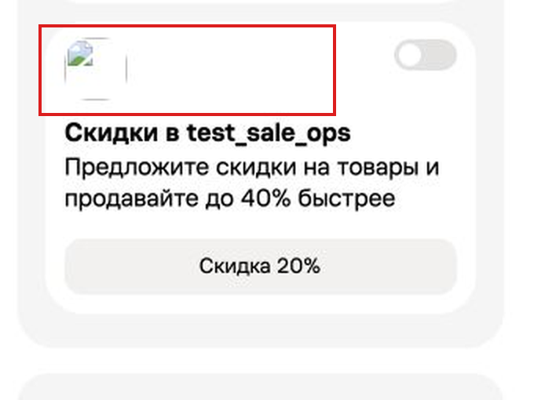
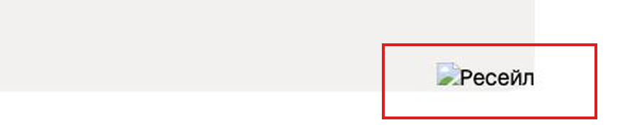
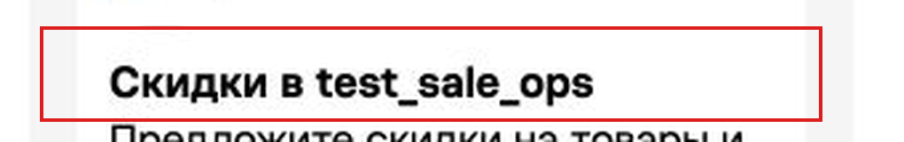
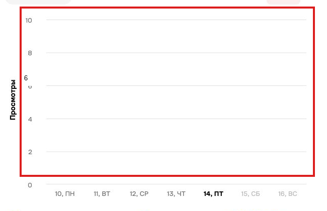
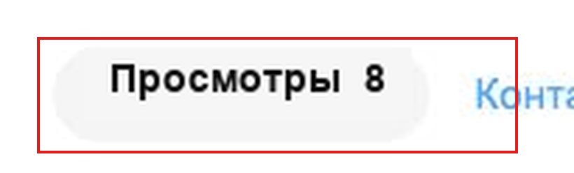

# Баги

## Задание 1. Скриншоты

Объявление № 52291995943. Эталон - форма редактирования, проверены карточка продавца и карточка товара.

### Сводка

| ID | P | Экран | Дефект |
|---|---|---|---|
| BUG-01 | P1 | Карточка товара | Цена 52 000 ₽ вместо 25 000 ₽ |
| BUG-02 | P1 | Карточка товара | «Доставка недоступна», хотя Авито Доставка включена |
| BUG-03 | P1 | Карточка товара | Диван «прямой», «не модульный», без спального места и механизма |
| BUG-04 | P1 | Карточка товара | «в наличии 3 шт.» вместо 1 шт. |
| BUG-05 | P1 | Карточка товара | Обивка, каркас и механизм «требуют замены/ремонта» |
| BUG-06 | P1 | Карточка товара | Адрес «пл. Революции, 5» вместо 3 |
| BUG-07 | P2 | Карточка продавца | Заголовок «Диван прямой» вместо «Диван угловой модульный» |
| BUG-08 | P2 | Карточка товара | Высота и глубина перепутаны местами |
| BUG-09 | P2 | Обе карточки | «На проверке» у продавца и «Опубликовано» в карточке товара |
| BUG-10 | P2 | Обе карточки | Просмотры: 8 у продавца и 0 в карточке товара |
| BUG-11 | P2 | Обе карточки | В описании и «Особенностях» текст, которого нет в форме |
| BUG-12 | P3 | Карточка продавца | Битая картинка в акции «Скидки в test_sale_ops» |
| BUG-13 | P3 | Карточка товара | Битая картинка в баннере «Найти своё на ресейле» |
| BUG-14 | P3 | Карточка продавца | Служебное имя «test_sale_ops» в интерфейсе |
| BUG-15 | P3 | Форма редактирования | Заголовок «Внешний вид» напечатан дважды |
| BUG-16 | P3 | Карточка продавца | График статистики пустой при 8 просмотрах |
| BUG-17 | P3 | Карточка продавца | В плашке «Просмотры 8» текст прижат к верху |
| BUG-18 | P3 | Карточка товара | В строке «Опубликовано» срезаны хвосты «у» и «р» |

### BUG-01. Цена 52 000 ₽ вместо 25 000 ₽

**P1** · карточка товара, цена справа от заголовка

**Шаги:** в форме «Цена» - 25 000 руб., открыть карточку товара.

**Факт:** 52 000 ₽. **Ожидаемо:** 25 000 ₽.

Покупатель видит цену, которую продавец не выставлял.

### BUG-02. «Доставка недоступна» при включённой доставке

**P1** · карточка товара, блок под ценой

**Шаги:** в форме «Авито Доставка» - «Включена», «Выбраны 2 способа отправки»; открыть карточку товара.

**Факт:** «Доставка недоступна», подпись «Продавец отключил доставку для объявления». **Ожидаемо:** доставка доступна, способы отправки из формы.

В карточке продавца тумблер включён - расходится только карточка товара.

### BUG-03. Диван описан как прямой, не модульный и без спального места

**P1** · карточка товара, блок «Характеристики»

**Шаги:** в форме Форма - «Угловой», Модульный - «Да», Спальное место - «Есть», Раскладной механизм - «Есть»; открыть карточку товара.

| Поле | Карточка товара | Форма |
|---|---|---|
| Форма | Прямой | Угловой |
| Модульный | Нет | Да |
| Спальное место | Нет | Есть |
| Раскладной механизм | Нет | Есть |

**Ожидаемо:** значения из формы.

Карточка противоречит и себе: в заголовке «Диван угловой модульный», ниже «Прямой» и «Модульный: Нет». При «Спальное место: Нет» выводится «Размер спального места: 140 × 200 см», при «Раскладной механизм: Нет» - «Тип механизма: Еврокнижка».

### BUG-04. «в наличии 3 шт.» вместо 1 шт.

**P1** · карточка товара, строка под ценой

**Шаги:** в форме «Количество» - 1 шт.; открыть карточку товара.

**Факт:** «Опубликовано · в наличии 3 шт.». **Ожидаемо:** «Опубликовано · в наличии 1 шт.».

В карточке продавца - 1 шт.

### BUG-05. Обивка, каркас и механизм «требуют ремонта»

**P1** · карточка товара, блок «О диване»

**Шаги:** в форме «Состояние товара» - обивка, механизм и каркас «Всё в порядке»; открыть карточку товара.

| Поле | Карточка товара | Форма |
|---|---|---|
| Состояние обивки | Требует замены | Всё в порядке |
| Раскладной механизм | Требуется ремонт | Всё в порядке |
| Каркас | Требуется ремонт | Всё в порядке |

**Ожидаемо:** «Всё в порядке» во всех трёх строках.

В карточке продавца эти поля совпадают с формой. Получается «Отличное» состояние с каркасом, требующим ремонта.

### BUG-06. Адрес «пл. Революции, 5» вместо 3

**P1** · карточка товара, блок «Местоположение»

**Шаги:** в форме «Адрес» - «Москва, пл. Революции, 3»; открыть карточку товара.

**Факт:** «Москва, пл. Революции, 5». **Ожидаемо:** «Москва, пл. Революции, 3».

В карточке продавца адрес правильный.

### BUG-07. Заголовок «Диван прямой» в карточке продавца

**P2** · карточка продавца, заголовок над строкой статуса

**Шаги:** в форме «Название» - «Диван угловой модульный QA Sofa 2026 раскладной»; открыть карточку продавца.

**Факт:** «Диван прямой QA Sofa 2026 раскладной». **Ожидаемо:** «Диван угловой модульный QA Sofa 2026 раскладной».

Ниже на том же экране - «Форма: Угловой», «Модульный: Да».

### BUG-08. Высота и глубина перепутаны

**P2** · карточка товара, «Характеристики», правый столбец

**Шаги:** в форме Ширина - 220 см, Глубина - 95 см, Высота - 85 см; открыть карточку товара.

**Факт:** Высота - 95 см, Глубина - 85 см. **Ожидаемо:** Высота - 85 см, Глубина - 95 см.

В карточке продавца размеры правильные.

### BUG-09. «На проверке» и «Опубликовано» одновременно

**P2** · карточка продавца, строка под заголовком; карточка товара, строка под ценой

**Шаги:** открыть карточку продавца, затем карточку товара того же объявления.

**Факт:** «На проверке · 1 шт. · Осталось 30 дней» и «Опубликовано · в наличии 3 шт.». **Ожидаемо:** одинаковый статус.

### BUG-10. Просмотры 8 и 0 у одного объявления

**P2** · карточка продавца, «Статистика за неделю»; карточка товара, строка под блоком «Спросите у продавца»

**Шаги:** открыть карточку продавца, затем карточку товара.

**Факт:** «Просмотры 8» и «0 просмотров (+0 сегодня)». **Ожидаемо:** одно и то же число.

### BUG-11. В описании и «Особенностях» текст, которого нет в форме

**P2** · обе карточки, блок «Описание» и последняя строка «Характеристик»

**Шаги:** в форме «Описание» - «…Угловой раскладной диван.»; поля «Особенности» в форме нет; открыть карточку продавца и карточку товара.

**Факт:** в описании добавлено «с ящиком для белья, подлокотниками и подушками», отдельной строкой «Особенности: Ящик для белья, Подлокотники, Подушки». **Ожидаемо:** описание из формы; «Особенности» либо редактируются в форме, либо не выводятся.

### BUG-12. Битая картинка в акции «Скидки в test_sale_ops»

**P3** · карточка продавца, «Привлекайте покупателей», вторая карточка акции

**Шаги:** открыть карточку продавца, прокрутить до блока акций.

**Факт:** вместо иллюстрации - заглушка битого изображения. **Ожидаемо:** картинка загружается.

У первой акции иконка на месте, дело в конкретном файле.

### BUG-13. Битая картинка в баннере «Найти своё на ресейле»

**P3** · карточка товара, баннер под «Местоположением»

**Шаги:** открыть карточку товара, посмотреть правый нижний угол баннера.

**Факт:** alt-текст «Ресейл» вместо изображения. **Ожидаемо:** изображение баннера.

### BUG-14. Служебное имя «test_sale_ops» в интерфейсе

**P3** · карточка продавца, «Привлекайте покупателей», вторая акция

**Шаги:** открыть карточку продавца, прочитать заголовок второй акции.

**Факт:** «Скидки в test_sale_ops». **Ожидаемо:** название для пользователя, например «Скидки на товары».

### BUG-15. Заголовок «Внешний вид» напечатан дважды

**P3** · форма редактирования, над блоком «Фотографии»

**Шаги:** открыть форму редактирования, посмотреть на заголовок секции с фотографиями.

**Факт:** два заголовка «Внешний вид» один под другим, строки наезжают. **Ожидаемо:** один заголовок.

### BUG-16. График статистики пустой при 8 просмотрах

**P3** · карточка продавца, «Статистика за неделю», область графика

**Шаги:** открыть карточку продавца, сравнить счётчик «Просмотры 8» и график за 10.08-16.08.

**Факт:** оси и подписи дней есть, данных нет. **Ожидаемо:** на графике видны те же 8 просмотров.

### BUG-17. В плашке «Просмотры 8» текст прижат к верху

**P3** · карточка продавца, «Статистика за неделю», левая плашка в строке переключателей

**Шаги:** открыть карточку продавца, посмотреть на плашку «Просмотры 8».

**Факт:** текст стоит выше середины плашки, снизу зазор заметно больше, чем сверху. **Ожидаемо:** текст по центру.

### BUG-18. В строке «Опубликовано» срезаны хвосты букв

**P3** · карточка товара, зелёная строка под ценой

**Шаги:** открыть карточку товара, посмотреть на строку «Опубликовано · в наличии 3 шт.».

**Факт:** у «у» и «р» обрезаны нижние хвосты; соседние строки того же кегля ниже и целые. **Ожидаемо:** буквы не обрезаны.

Кнопка «Доставка недоступна» тут ни при чём - между ней и текстом есть чистое поле, режет сам текстовый блок.

## Задание 2. API

Окружение для всех дефектов раздела: стенд `https://qa-internship.avito.com`, запросы с Bearer-токеном пользователя, созданного на прогоне. Каждый дефект воспроизводится автотестом: тест помечен `@KnownBug` и в прогоне виден как пропущенный с номером дефекта. После исправления такой тест начнёт падать с требованием снять пометку.

### Сводка

| ID | Серьёзность | Ручка | Дефект |
|---|---|---|---|
| API-01 | Критическая | DELETE /api/2/item/{id} | Чужой пользователь удаляет чужое объявление |
| API-02 | Высокая | GET /api/1/statistic/{id} | Статистика удалённого объявления продолжает отдаваться |
| API-03 | Высокая | POST /api/1/item | Отрицательные цена и счётчики статистики принимаются |
| API-04 | Средняя | POST /api/1/item | Нулевые значения считаются «полем не переданным» |
| API-05 | Средняя | DELETE /api/2/item/{id} | Повторное удаление: HTTP 404, в теле `status: 500` |
| API-06 | Средняя | POST /api/1/item | Ошибки типов маскируются под «не передано тело» |
| API-07 | Низкая | GET /api/1/item/{id} | В createdAt смещение часового пояса задвоено |
| API-08 | Низкая | GET /api/1/register | 401 вместо 405 |
| API-09 | Низкая | GET /api/2/statistic/{id} | 404 вместо 400 на некорректный id |
| API-10 | Низкая | POST /api/1/item | Название из одних пробелов принимается |
| API-11 | Низкая | register, autorize | Короткие логин и пароль дают «invalid JSON body» |

### API-01. Чужой пользователь удаляет чужое объявление

**Серьёзность:** критическая, P0

**Шаги:**
1. Пользователь A создаёт объявление, получает id.
2. Пользователь B регистрируется и получает свой токен.
3. B отправляет `DELETE /api/2/item/{id}` с объявлением A.

**Факт:** 200 без тела, объявление исчезает: у A `GET /api/1/item/{id}` отдаёт 404.
**Ожидаемо:** 403 или 404, объявление остаётся доступным владельцу.

**Почему критично:** любой зарегистрированный пользователь может вычистить чужие объявления, зная их UUID. Проверка владельца при удалении отсутствует.

**Автотест:** `DeleteItemTest.foreignItem`

### API-02. Статистика удалённого объявления продолжает отдаваться

**Серьёзность:** высокая, P1

**Шаги:**
1. Создать объявление.
2. Удалить его через `DELETE /api/2/item/{id}`.
3. Запросить `GET /api/1/statistic/{id}` и `GET /api/2/statistic/{id}`.

**Факт:** обе версии отвечают 200 со счётчиками удалённого объявления.
**Ожидаемо:** 404, как и у самого объявления.

**Почему важно:** удаление не удаляет данные. Покупатель и партнёрские интеграции продолжают получать статистику по несуществующему объявлению.

**Автотест:** `StatisticTest.afterDeletion`

### API-03. Отрицательные цена и счётчики статистики принимаются

**Серьёзность:** высокая, P1

**Шаги:**
1. `POST /api/1/item` с `price: -500`.
2. `POST /api/1/item` с `statistics: {likes: -1, viewCount: 2, contacts: 3}`.
3. Прочитать созданные объявления.

**Факт:** оба запроса получают 200, значения сохраняются: `GET` возвращает `price: -500` и `likes: -1`.
**Ожидаемо:** 400 с сообщением о недопустимом значении.

**Почему важно:** отрицательная цена проходит дальше в витрину и в расчёты; отрицательные счётчики ломают статистику.

**Автотест:** `CreateItemTest.negativePrice`, `CreateItemTest.negativeStatistics`

### API-04. Нулевые значения считаются «полем не переданным»

**Серьёзность:** средняя, P2

**Шаги:**
1. `POST /api/1/item` с `price: 0`.
2. `POST /api/1/item` с `statistics: {likes: 0, viewCount: 0, contacts: 0}`.
3. `POST /api/1/item` с `statistics: {likes: 0, viewCount: 1, contacts: 1}`.

**Факт:** во всех трёх случаях 400: «поле price обязательно», «поле likes обязательно».
**Ожидаемо:** 200 - ноль валидное значение для цены и счётчиков.

**Почему важно:** объявление с нулевой статистикой создать нельзя, а сообщение об ошибке вводит в заблуждение: поле передано, просто равно нулю.

**Автотест:** `CreateItemTest.zeroPrice`, `CreateItemTest.zeroStatistics`

### API-05. Повторное удаление: HTTP 404, в теле status 500

**Серьёзность:** средняя, P2

**Шаги:**
1. Создать объявление и удалить его.
2. Повторить `DELETE /api/2/item/{id}`.
3. Отдельно: `DELETE /api/2/item/{случайный uuid}`.

**Факт:** HTTP 404, тело `{"result":{"message":"","messages":null},"status":"500"}` - в теле код 500 и пустое сообщение.
**Ожидаемо:** HTTP 404 и в теле `status: "404"` с понятным сообщением.

**Почему важно:** клиент, который ориентируется на поле `status`, считает это ошибкой сервера и может уйти в ретраи.

**Автотест:** `DeleteItemTest.repeatedDeleteStatus`, `DeleteItemTest.unknownDeleteStatus`

### API-06. Ошибки типов маскируются под «не передано тело»

**Серьёзность:** средняя, P2

**Шаги:**
1. `POST /api/1/item` с `price: 10.5`.
2. `POST /api/1/item` с `sellerID: "83629"` (строкой).
3. `POST /api/1/item` со строковыми счётчиками статистики.

**Факт:** 400 и тело `{"result":{"message":"","messages":{}},"status":"не передано тело объявления"}`: сообщение пустое, а в поле `status` лежит текст вместо кода.
**Ожидаемо:** 400 с указанием проблемного поля и числовым `status`.

**Почему важно:** разработчик не понимает, что именно не так, а автоматика, читающая `status`, получает текст.

**Автотест:** `CreateItemTest.fractionalPriceMessage`, `ContractTest.bodyStatusIsCode`

### API-07. В createdAt смещение часового пояса задвоено

**Серьёзность:** низкая, P3

**Шаги:**
1. Создать объявление.
2. `GET /api/1/item/{id}` и посмотреть `createdAt`.

**Факт:** `"createdAt": "2026-11-25 14:51:55.542464 +0300 +0300"`.
**Ожидаемо:** дата в ISO-8601 с одним смещением, например `2026-11-25T14:51:55.542+03:00`.

**Почему важно:** строку не разбирает стандартный парсер дат, а шесть знаков после точки не соответствуют ни одному популярному формату.

**Автотест:** `GetItemTest.createdAtFormat`

### API-08. GET на ручку регистрации отвечает 401 вместо 405

**Серьёзность:** низкая, P3

**Шаги:**
1. `GET /api/1/register` без токена.

**Факт:** 401 «valid bearer token is required».
**Ожидаемо:** 405 Method Not Allowed: метод не поддерживается, токен тут ни при чём.

**Автотест:** `RegisterTest.methodNotAllowed`

### API-09. Версия 2 статистики отвечает 404 на некорректный id

**Серьёзность:** низкая, P3

**Шаги:**
1. `GET /api/1/statistic/abc`.
2. `GET /api/2/statistic/abc`.

**Факт:** версия 1 отдаёт 400, версия 2 - 404, хотя в теле обеих `status: "400"`.
**Ожидаемо:** одинаковый код в обеих версиях (400), совпадающий с телом.

**Автотест:** `StatisticTest.sameCodeForMalformedId`

### API-10. Название из одних пробелов принимается

**Серьёзность:** низкая, P3

**Шаги:**
1. `POST /api/1/item` с `name: "    "`.

**Факт:** 200, объявление создаётся с пустым по смыслу названием.
**Ожидаемо:** 400: строка из пробелов не является названием.

**Автотест:** `CreateItemTest.blankName`

### API-11. Короткие логин и пароль дают «invalid JSON body»

**Серьёзность:** низкая, P3

**Шаги:**
1. `POST /api/1/register` с username `ab`.
2. `POST /api/1/register` с username `"   "`.
3. `POST /api/1/autorize` с паролем `123`.

**Факт:** в случаях 1 и 3 - 400 `{"error":"invalid JSON body"}`, хотя JSON корректный. В случае 2 сообщение нормальное: «username must contain from 3 to 64 characters».
**Ожидаемо:** во всех случаях сообщение о нарушенном правиле, а не про JSON.

**Почему важно:** сообщение уводит в сторону: ищешь проблему в сериализации, а дело в длине.

**Автотесты:** `RegisterTest.shortUsernameMessage`, `AuthorizeTest.shortPasswordMessage`

### Замечания без баг-репорта

Два момента, которые не оформлены как дефекты: в задании нет требований ни к формату ошибок, ни к именам полей, поэтому нарушением контракта это не считаю.

- **Ошибки приходят в трёх форматах.** Авторизация отдаёт `{"error": "..."}`, валидация - `{"result": {...}, "status": "400"}`, разбор тела - `{"message": "...", "code": 400}`. Формат в задании не задан, так что это рекомендация: один формат упростил бы жизнь клиенту.
- **Поле продавца называется по-разному.** В запросе `sellerID`, в ответе `sellerId`. Тоже не нарушение, но модель, собранная по ответу, не подойдёт для запроса.
